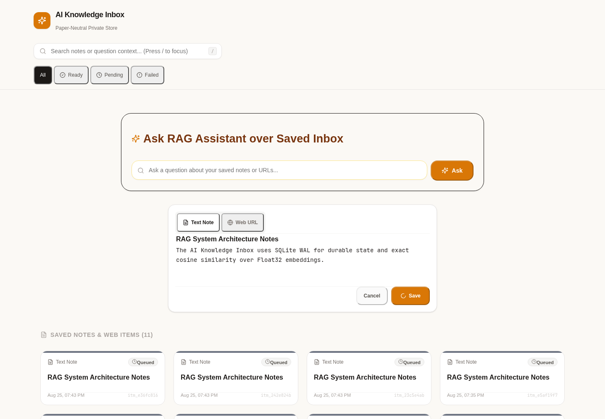

# AI Knowledge Inbox

> A single-user private knowledge inbox application built with React, Express, Node.js, TypeScript, and SQLite. Ingests plain-text notes or public web URLs, asynchronously chunks and embeds content, and provides a retrieval-augmented generation (RAG) Q&A experience with cited sources.



## Architecture Overview

```text
[ React SPA (Google Keep-inspired UI) ]
                   │ (HTTP JSON)
                   ▼
┌────────────────────────────────────────────────────────┐
│ Express API                                            │
│ - POST /ingest, GET /items, GET /items/:id, POST /query│
│ - Storage: SQLite WAL + In-Memory Disposable Vector    │
└───────────┬────────────────────────────────────────────┘
            │
            ├───────────────────────┐ (claim/write durable jobs)
            ▼                       ▼
┌────────────────────────┐  ┌────────────────────────────────────┐
│ SQLite Database        │  │ Ingestion Worker                   │
│ - items, jobs, chunks, │  │ - SSRF-safe Fetcher (5 redirects)  │
│   embeddings, events   │  │ - HTML Extractor & Paragraph Chunker│
└────────────────────────┘  │ - OpenAI Embedding Publisher       │
                            └────────────────────────────────────┘
```

## Key Trade-Offs & Rationale

### 1. Chunking Strategy Rationale
We employ a **paragraph-aware deterministic chunker** targeting **800 tokens** per chunk with **120 tokens overlap** between adjacent chunks (~4 characters per token approximation):
- **Paragraph boundaries (`\n\n`):** Preserves semantic coherence by avoiding arbitrary sentence cuts.
- **800-token target:** Fits well within OpenAI embedding models (`text-embedding-3-small` / 1536d) while providing enough semantic context for RAG chunk retrieval.
- **120-token overlap:** Ensures key transitions between paragraphs are captured across chunk boundaries.
- **Sliding window for long paragraphs:** Paragraphs >800 tokens are split using a sliding window to guarantee bounded chunk sizes.

### 2. Vector Storage & Retrieval Choice
- **Durable Source of Truth:** SQLite (`better-sqlite3` in WAL mode) storesFloat32 embedding BLOBs in the `chunks` table (`dimensions * 4` bytes).
- **Disposable API Vector Index:** The API maintains a complete, process-local in-memory vector snapshot built from ready chunks. Cosine similarity ranking is exact and O(N) over up to 10,000 items.
- **Atomic Index Reload:** When `index_version` bumps or on startup, the API reloads ready chunks off to the side and performs an atomic pointer swap, avoiding query lock contention.

### 3. SSRF & Fetch Security Controls
- **Protocol & Port Restrictions:** Only `http:` and `https:` protocols on standard ports (80, 443) are accepted. Credentials in URLs are forbidden.
- **DNS & IP Validation:** Target hostnames are resolved via DNS prior to connection. Loopback (`127.0.0.0/8`, `::1`), private (`10.0.0.0/8`, `172.16.0.0/12`, `192.168.0.0/16`), link-local (`169.254.0.0/16`), multicast (`224.0.0.0/4`), and reserved IP ranges are blocked.
- **Redirect Revalidation:** Up to 5 redirects are manually followed, with every hop independently revalidated against SSRF IP policies to prevent DNS rebinding attacks.
- **Streaming & Content Caps:** 30-second overall timeout, 10-second connect budget, 2 MiB streamed body limit, and strict `text/html` / `text/plain` Content-Type validation.

### 4. Scale Breakpoints & Production Evolution
- **Current Limits:** Designed for single-operator use up to 10,000 items on local hardware.
- **Breakpoints:** Single SQLite writer bottleneck, process-local in-memory vector index memory footprint, single-worker polling queue.
- **Production Path:** Migrate jobs and items to PostgreSQL, vectors to `pgvector` / managed vector DB, replace worker polling with Redis/SQS queue, deploy stateless API and worker instances.

## AI Provider Data Disclosure

Raw document text, questions, and embedding requests are sent to the configured OpenAI-compatible API endpoint (`AI_BASE_URL`). Ensure non-public or sensitive information is handled according to your AI provider's data privacy policies.

## Visual & Interaction Design Signature

- **Google Keep-Inspired Interaction:** Low-friction collapsed composer ("Take a note or paste a URL...") that expands in place on focus, combined with a responsive 4-column desktop / 2-column tablet / 1-column mobile card grid.
- **Original Visual Identity:** Warm paper-neutral canvas (`#FBF9F5`), charcoal text (`#1C1917`), soft white cards (`#FFFFFF`), and gold accent (`#D97706`).
- **Knowledge Pulse Signature:** Slim edge indicator on each note card communicating `queued`, `processing`, `ready`, or `failed` status, combined with accessible non-color-only icon + text badges.

## Quick Start with Docker Compose

1. Clone the repository:
   ```bash
   git clone <repository_url>
   cd ai-knowledge-box
   ```

2. Copy environment file:
   ```bash
   cp .env.example .env
   ```

3. Launch with Docker Compose:
   ```bash
   docker compose up --build
   ```

4. Access the web UI at `http://127.0.0.1:3000`.

## Local Development Setup

Requirements: Node.js 22 LTS, npm 12+

```bash
# Install monorepo dependencies
npm install

# Build all packages and applications
npm run build

# Run unit and integration tests
npm test

# Run Playwright E2E tests
npm run test:e2e

# Start development API server
npm run dev
```

## Backup & Restore Runbook

To backup the SQLite database:
1. Copy `/data/knowledge.db` (or run `sqlite3 /data/knowledge.db ".backup '/data/backup.db'"`).
2. To restore: stop containers, replace `/data/knowledge.db`, run `PRAGMA integrity_check`, and restart.

## Verification & Test Matrix

- `npm run typecheck` — TypeScript strict type checks
- `npm run lint` — ESLint validation
- `npm test` — Vitest unit & integration test suite (162 tests)
- `npm run test:e2e` — Playwright end-to-end browser flows & responsive viewport screenshots
