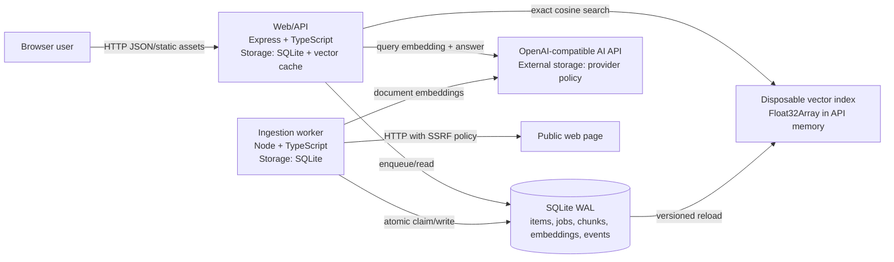
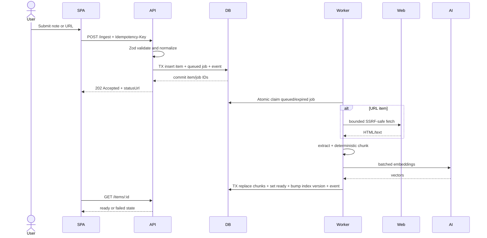
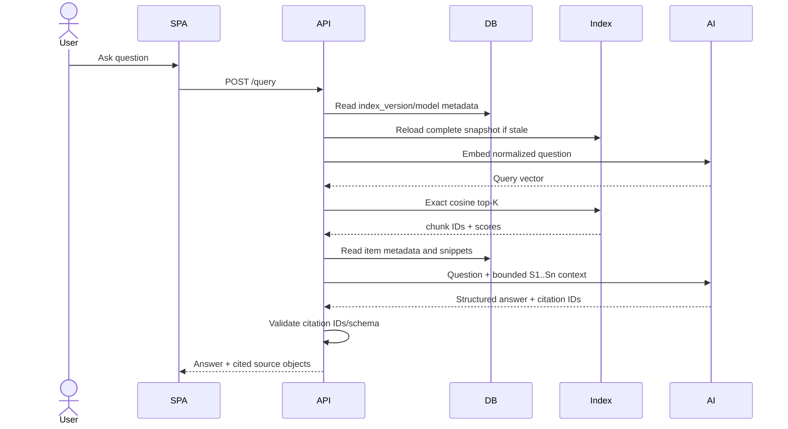
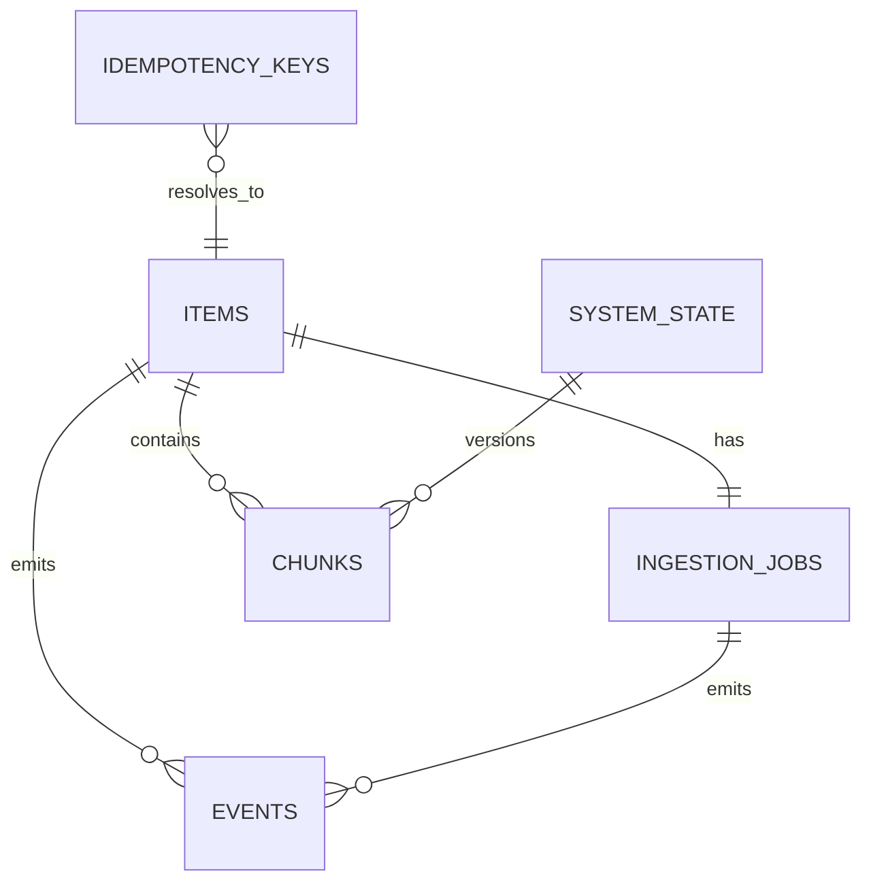
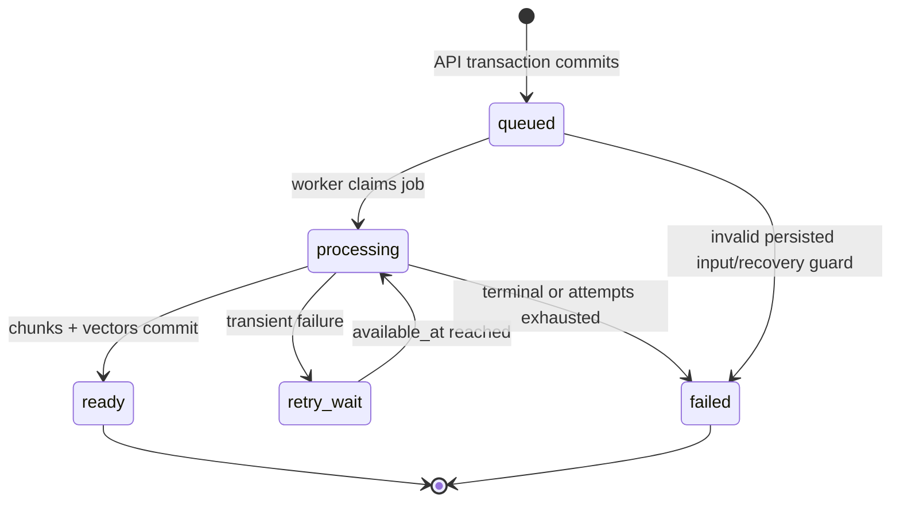

# AI Knowledge Inbox — System Design

> **Decision gate:** Approved by Priyesh on 2026-08-25 for local implementation on the Gaming PC. Approval does not authorize public deployment, Caddy/DNS changes, authentication redesign, or merging without review.

## 1. Executive summary and scope boundaries

AI Knowledge Inbox is a single-user web application that accepts plain-text notes or public web URLs, asynchronously turns their content into searchable chunks and embeddings, and answers questions with source citations through a retrieval-augmented generation (RAG) pipeline.

The design intentionally fits the assignment's 6–12 hour implementation target: a React/Vite SPA, an Express/TypeScript API, a separate TypeScript ingestion worker, and one SQLite database in WAL mode. SQLite is the durable source of truth for items, jobs, chunks, embeddings, and audit events. The API keeps only a disposable in-process vector cache; cosine similarity remains exact and simple for the approved ceiling of 10,000 items.

### In scope

- Add a plain-text note or HTTP(S) URL.
- Durable asynchronous URL fetch, text extraction, chunking, and embedding.
- List saved items and their ingestion state.
- Ask a question, retrieve relevant chunks, generate an answer, and cite source snippets.
- Structured logs, typed validation, explicit errors, health checks, retries, and recovery.
- Local Docker Compose deployment with one API process and one worker.

### Out of scope

- Authentication, accounts, sharing, roles, deletion, editing, file upload, crawling linked pages, browser rendering, OCR, streaming answers, and mobile-native clients.
- Kubernetes, Redis, a dedicated vector database, or horizontal scaling.
- Guaranteed availability; this is a private/trusted-use interview application.

## 2. Requirements, assumptions, decisions, and traceability

| ID | Requirement / constraint | Design decision | Source |
|---|---|---|---|
| F1 | Save short notes or URLs | `POST /ingest` accepts a discriminated `text` or `url` body and returns `202` with an item/job status URL. | Assignment |
| F2 | Server-side URL fetch | Worker fetches one supplied public HTTP(S) page with SSRF checks, redirects revalidated, 30 s deadline, 2 MiB cap, and HTML/text content types only. | Assignment + confirmed scope |
| F3 | Store raw content and metadata | SQLite `items` owns submitted value, extracted raw text, type, canonical URL, title, timestamps, content hash, and lifecycle state. | Assignment |
| F4 | Intentional chunking | Paragraph-aware chunks target 800 tokens with 120-token overlap; long paragraphs are token-windowed. | Design choice |
| F5 | Embeddings | OpenAI-compatible API; default `text-embedding-3-small`/1536 dimensions, configurable through environment variables. Model and dimensions are persisted per chunk. | Confirmed stack |
| F6 | Vector storage/search | Float32 embedding BLOBs live in SQLite; API maintains a reloadable in-memory index and exact cosine-ranks ready chunks. | Explicit user choice |
| F7 | RAG answers with citations | Retrieve top 5 (max 10), construct bounded context labels `S1…Sn`, ask the chat model for grounded JSON, reject unknown citation IDs, and return snippets. | Assignment |
| F8 | Frontend | React + TypeScript + Vite, hooks, small API/query hooks, clear ingestion and answer states; Tailwind/shadcn not required. | Assignment + explicit user choice |
| F9 | Required endpoints | `POST /ingest`, `GET /items`, and `POST /query`; add `GET /items/:id` and health endpoints for status/debugging. | Assignment |
| F10 | Note creation and viewing experience | Use a Google Keep-inspired interaction model: a compact collapsed composer that expands on focus, a responsive masonry-like note-card grid, immediate accessible note opening, and search-first scanning. Preserve an original visual identity and do not copy Google branding, icons, or exact styling. | Explicit user direction |
| N1 | Debuggability | Pino JSON logs, request/job correlation IDs, stable error codes, ingestion audit events, health/readiness probes. | Assignment |
| N2 | Separation of concerns | Monorepo packages isolate HTTP, application services, domain types, persistence, AI clients, fetching, extraction, chunking, and worker concerns. | Assignment |
| N3 | Operating scope | Local Docker Compose, one API and one worker, no auth, private/trusted use, ≤10,000 items, best-effort availability. | Explicit user choice |
| N4 | Avoid overengineering | No external queue/vector service; SQLite provides the durable job queue and vector source of truth. | Assignment |

### Confirmed technology decisions

- Node.js 22 LTS, TypeScript strict mode.
- Express API and worker processes from the same application image.
- React 19 + Vite SPA; Express serves the production `dist/` assets.
- SQLite through `better-sqlite3`, with Drizzle ORM/migrations.
- Zod contracts shared by API and web client.
- OpenAI-compatible embeddings and chat through the official OpenAI JavaScript client configured with `AI_BASE_URL` and `AI_API_KEY`.
- Vitest, Supertest, React Testing Library, and Playwright for verification.

### Low-impact defaults

- Page size 25, maximum 100; newest items first.
- One ingestion worker with polling every 500 ms.
- Three retryable attempts with exponential backoff and jitter.
- Raw/extracted content and chunks retained indefinitely for the life of the local database; logs retained by Docker rotation, not in SQLite.
- All timestamps stored as UTC ISO-8601 strings and displayed in browser-local time.

### Frontend visual and interaction direction

- **Subject / audience / job:** a private knowledge inbox for one operator; the home screen's primary job is to capture a thought or URL with near-zero friction and make existing notes immediately scannable.
- **Google Keep-inspired interaction model:** place a restrained collapsed composer near the top of the content area with the prompt “Take a note or paste a URL…”. Focus/click expands it in place to title, body/URL mode, and explicit **Save** / **Cancel** actions. Saving inserts a pending card optimistically only after the API returns durable `202`.
- **Note viewing:** show items as content-led cards in a responsive masonry-like CSS grid: four columns on wide desktop, two on tablet, one on mobile. Cards expose title, a bounded text preview or hostname, browser-local timestamp, and a compact ingestion-status treatment. Selecting a card opens a centered detail dialog on desktop and a full-height sheet on mobile; long content scrolls inside the viewer without changing the list position.
- **Visual identity:** inspiration is behavioral, not a clone. Use a warm paper-like neutral canvas, charcoal text, white/soft-tint cards, one restrained golden accent, subtle elevation, 12–16 px radii, and system typography. Do not use Google logos, Keep's exact palette, proprietary icons, or pixel-matched geometry. The product signature is a slim “knowledge pulse” edge on each card that communicates `queued`, `processing`, `ready`, or `failed` without dominating the note.
- **Controls and states:** keyboard shortcut `/` focuses search; `n` focuses the composer when no text field is active; `Escape` closes/cancels. Hover-only actions must also be keyboard reachable and visible on focus. Empty state points to the composer; pending cards show calm progress; failures show a plain-language retry/submission path; source URL and citations remain explicit.
- **Responsive/accessibility invariants:** no document-level horizontal scrolling at 390 px, visible focus, semantic dialog/focus trap/return, WCAG AA text contrast, 44 px mobile targets, reduced-motion support, and no color-only status. Acceptance viewports are 1440×1000, 768×1024, and 390×844.
- **Scope guard:** pinning, labels, archival, checklist notes, drag reordering, and per-note color editing are not implied by the visual inspiration and remain out of scope unless separately approved.

## 3. Architecture



### Component contracts

| Component | Responsibility | Interface | Dependencies | Storage / scaling | Failure behavior |
|---|---|---|---|---|---|
| React SPA | Capture note/URL through the Keep-inspired expandable composer; scan a responsive card grid; open an accessible note detail dialog/sheet; ask questions and render answer/citations/errors. | Required HTTP endpoints; polls pending item every 1 s with backoff. | API only. | No durable storage; one browser session. | Keeps entered text on recoverable errors, preserves list position around note viewing, and shows a stable code/request ID. |
| Express API | Validate requests, create item/job transactionally, list/read items, run query pipeline, serve SPA. | HTTP JSON and static files. | SQLite, AI client, vector index. | One process; SQLite + memory index. | No mutation on validation failure; returns typed error; readiness fails if DB/schema/index unavailable. |
| Ingestion worker | Claim durable jobs; fetch/extract/chunk/embed; publish results atomically; retry/recover. | SQLite job records; outbound HTTP/AI. | SQLite, web origin, AI client. | One process; no private durable store. | Retry transient failures; terminally fail safe; expired leases are reclaimed. |
| URL fetcher | Enforce URL policy and bounded fetch. | `fetchPublicDocument(url, policy)`. | DNS + public site. | None. | Blocks non-public destinations and invalid redirects; bounded timeout/size. |
| Text extractor/chunker | Convert HTML/text to normalized text and deterministic token chunks. | Pure typed functions. | `linkedom` or `cheerio`, tokenizer. | None. | Empty/too-short content is terminal `CONTENT_NOT_EXTRACTABLE`. |
| AI gateway | Generate batched document/query embeddings and grounded answers. | OpenAI-compatible REST via SDK. | External provider. | Provider-controlled; no local DB. | Timeouts; retry 429/5xx/network; terminal auth/model errors. |
| SQLite repository/queue | Own state, constraints, migrations, claims, transactions, index version. | Drizzle repositories; no raw SQL outside persistence package. | SQLite file volume. | WAL; one API writer and one worker writer. | `busy_timeout=5000`; bounded lock retries; startup migration lock. |
| Vector index | Exact cosine ranking over ready chunk vectors. | `reload(version)`, `search(vector, topK)`. | SQLite chunks. | Disposable API memory; single process. | Old complete snapshot remains usable during reload; readiness fails on dimension mismatch. |

### Suggested repository layout

```text
apps/
  api/src/{routes,middleware,services,index.ts}
  worker/src/{runner,processors,index.ts}
  web/src/{components,hooks,lib,pages}
packages/
  contracts/src/       # Zod request/response/error schemas
  domain/src/          # states, transitions, pure policies
  db/src/              # schema, migrations, repositories, queue
  ingestion/src/       # fetch, extract, chunk
  ai/src/              # embedding/chat clients and prompt builder
  observability/src/   # logger and correlation context
```

## 4. Core flows, consistency, and idempotency

### Ingestion sequence



**Consistency boundary:** item creation, job creation, and `ingest.accepted` event commit in one transaction. Final chunks, embeddings, item `ready`, job `succeeded`, index version increment, and completion event commit in another transaction. Partially generated chunks are never visible.

**Idempotency:** clients should supply an `Idempotency-Key` (UUID, max 128 chars). A unique row stores the key plus SHA-256 request hash and response IDs for 24 hours. Repeating the same key/body returns the original `202`; same key/different body returns `409 IDEMPOTENCY_CONFLICT`. Without a key, each valid request creates a new item. URL/content hashes are informational and do not silently deduplicate user intent.

### Query sequence



Queries use only chunks from `ready` items whose embedding model/dimension match the configured query model. The prompt states that source text is untrusted data, not instructions. If no chunk clears `MIN_RELEVANCE_SCORE`, the API returns an honest insufficient-context answer without calling the chat model.

## 5. API and event contracts

All JSON responses use `Content-Type: application/json`. Request bodies are capped at 256 KiB; text notes at 50,000 characters; questions at 2,000 characters; URLs at 2,048 characters. Unknown fields are rejected. There is no auth in the approved scope; bind the published Compose port to loopback/private access only.

### `POST /ingest`

Request, exactly one variant:

```json
{"type":"text","content":"A note...","title":"Optional title"}
```

```json
{"type":"url","url":"https://example.com/article"}
```

Headers: optional `Idempotency-Key`.

Response `202`:

```json
{"item":{"id":"itm_...","type":"url","status":"queued","createdAt":"2026-08-25T12:00:00.000Z"},"jobId":"job_...","statusUrl":"/items/itm_..."}
```

Errors: `400 VALIDATION_ERROR`, `409 IDEMPOTENCY_CONFLICT`, `413 PAYLOAD_TOO_LARGE`, `503 DATABASE_BUSY`.

### `GET /items?cursor=<createdAt,id>&limit=25&status=ready`

Response `200`:

```json
{"items":[{"id":"itm_...","type":"text","title":"...","sourceUrl":null,"status":"ready","createdAt":"...","updatedAt":"...","error":null}],"nextCursor":null}
```

Cursor ordering is `(created_at DESC, id DESC)`. Raw content and vectors are not returned by list APIs.

### `GET /items/:id`

Returns the same item summary plus `chunkCount` and latest safe error. Errors: `404 ITEM_NOT_FOUND`.

### `POST /query`

Request:

```json
{"question":"What did I save about rate limiting?","topK":5}
```

Response `200`:

```json
{
  "answer":"The notes recommend exponential backoff [S1].",
  "sources":[{"citationId":"S1","itemId":"itm_...","title":"Retry notes","url":null,"snippet":"...exponential backoff...","score":0.82}],
  "requestId":"req_..."
}
```

Errors: `400 VALIDATION_ERROR`, `409 INDEX_MODEL_MISMATCH`, `422 NO_READY_CONTENT`, `502 AI_PROVIDER_ERROR`, `503 INDEX_UNAVAILABLE`.

### Health endpoints

- `GET /health/live`: `200` if event loop/process is alive.
- `GET /health/ready`: `200` only when migrations are current, SQLite is writable, worker heartbeat is recent (warning may be included), and vector index metadata is compatible; otherwise `503` with checks.

### Error envelope

```json
{"error":{"code":"URL_PRIVATE_ADDRESS","message":"The URL does not resolve to a public address.","details":{},"requestId":"req_..."}}
```

Messages are safe for users; stack traces, API keys, raw provider responses, full fetched content, and resolved internal addresses stay out of responses/logs.

### Internal domain events

Events are persisted for debug/audit, not published externally: `ingest.accepted`, `ingest.started`, `ingest.retry_scheduled`, `ingest.succeeded`, `ingest.failed`, `index.reloaded`, and `query.completed`. Each has `id`, `item_id?`, `job_id?`, `request_id?`, `type`, safe JSON metadata, and `created_at`.

**Versioning:** assignment endpoints remain unprefixed. Breaking changes introduce `/v2/...`; additive fields are allowed in v1 responses. Shared Zod schemas are the contract source.

## 6. Data model



### Tables and constraints

| Table | Important columns | Constraints / indexes | Ownership and retention |
|---|---|---|---|
| `items` | `id`, `type`, `submitted_text`, `source_url`, `canonical_url`, `title`, `raw_content`, `content_hash`, `status`, `error_code`, `error_message`, timestamps | PK `id`; check type/status; index `(created_at,id)` and `status`; URL fields nullable only by type | API creates; worker updates. Retained for DB lifetime. |
| `ingestion_jobs` | `id`, `item_id`, `state`, `attempt`, `max_attempts`, `available_at`, `lease_owner`, `lease_expires_at`, `heartbeat_at`, `last_error_*`, timestamps | unique `item_id`; index `(state,available_at)`; valid lease/state checks | Worker owns transitions; retained for DB lifetime. |
| `chunks` | `id`, `item_id`, `ordinal`, `text`, `token_count`, `embedding` BLOB, `embedding_model`, `dimensions`, `content_hash`, `created_at` | unique `(item_id,ordinal)`; index `item_id`; positive dimensions/token count | Worker writes atomically; query reads. Replaced on reindex. |
| `events` | `id`, optional item/job/request IDs, `type`, `metadata_json`, `created_at` | indexes by item, job, and time | API/worker append only; retained for DB lifetime. |
| `idempotency_keys` | `key`, `request_hash`, `item_id`, `job_id`, `expires_at`, `created_at` | PK `key`; expiry index | API; prune after 24 h. |
| `system_state` | singleton `id=1`, `schema_version`, `index_version`, `embedding_model`, `embedding_dimensions`, `updated_at` | singleton check | DB/migrations and worker. |
| `worker_state` | `worker_id`, `heartbeat_at`, `started_at`, `version` | PK `worker_id` | Worker upsert; ephemeral operational row. |

IDs are application-generated UUIDv7 values with readable prefixes. Embeddings encode little-endian Float32 values; repository code verifies byte length equals `dimensions * 4` and normalizes vectors before storage. SQLite foreign keys are on, journal mode is WAL, `synchronous=NORMAL`, and `busy_timeout=5000`.

### Migration and model-change policy

Drizzle SQL migrations run once in the API container before readiness; worker refuses to start against a mismatched schema. A changed embedding model/dimension does **not** mix indexes: readiness reports `INDEX_MODEL_MISMATCH`, querying is disabled, and a future explicit reindex command must replace all chunk embeddings transactionally per item before updating `system_state`.

## 7. Stateful behavior

### Item lifecycle (owned by ingestion service)



| Transition | Trigger / guard | Side effects | Timeout/retry/recovery | Invalid transition |
|---|---|---|---|---|
| new → `queued` | API validated request and idempotency guard | Insert item/job/event atomically | DB lock retry up to 3; otherwise no item | Reject `409` for idempotency mismatch |
| `queued`/`retry_wait` → `processing` | Worker atomically claims eligible job; no valid lease | Set lease, attempt++, item status, event | Lease 60 s; heartbeat every 15 s | Claim affects zero rows; worker moves on |
| `processing` → `ready` | At least one valid chunk; all embeddings dimension-compatible | Replace chunks, clear error, succeed job, increment index version, event in one TX | Lock retry; generated vectors can be regenerated | Transition function rejects and logs invariant error |
| `processing` → `retry_wait` | Classified transient and attempts remain | Clear lease; set `available_at`; safe error/event | Delays 2 s, 8 s, 32 s + jitter | Reject if terminal or exhausted |
| `processing` → `failed` | Permanent failure or attempts exhausted | Clear lease; store safe code/message; event | Manual requeue is out of scope | Terminal state rejects mutation |

### Job lifecycle (owned by worker queue)

`queued → running → succeeded`; retry branch `running → retry_wait → running`; terminal branch `running → failed`. On startup and every 30 s, the worker reclaims `running` jobs with expired leases by moving them to `retry_wait` without decrementing attempts. One job is processed at a time. Side effects are idempotent because chunks are staged in memory and only replace existing item chunks in the final transaction.

### Vector index lifecycle (owned by API)

`uninitialized → loading → ready`; after `index_version` changes, `ready → reloading → ready`; malformed vectors/model mismatch lead to `degraded`. A reload builds a complete new map off to the side and swaps it atomically, so queries may use the previous complete snapshot while reloading. At startup there is no previous snapshot, so `/query` returns `503` until ready. The index has no durable lifecycle state beyond `system_state.index_version`.

### Query lifecycle

Queries are request-scoped and not durably queued: `validated → embedded → retrieved → generated → returned`, with terminal `insufficient_context` or `failed`. Client disconnect aborts provider calls where supported. No automatic chat retry occurs after a response body begins; this design returns one buffered JSON response.

## 8. Security, privacy, permissions, and abuse controls

- **No authentication by explicit scope:** deploy only on a developer machine/private trusted network; never expose directly to the public internet. Production evolution requires auth and per-user ownership columns before exposure.
- **SSRF:** accept only `http:`/`https:`; reject credentials, nonstandard ports by default, localhost names, IP literals/resolutions in loopback/private/link-local/multicast/reserved ranges, and DNS rebinding. Resolve and validate every connection and redirect hop (max 5). Proxy use is disabled.
- **Fetch limits:** 30 s total deadline, 10 s connect/header budget, 2 MiB streamed body cap, HTML/plain-text only, one page only, identifiable user agent.
- **Prompt injection:** fetched/note content is untrusted quoted context. System prompt forbids following source instructions. Tool calling is disabled. Output is schema-validated; citations must refer to supplied IDs.
- **Secrets:** `AI_API_KEY` enters through Compose environment/`.env`, is never committed, logged, returned, or sent to the browser. Provide `.env.example` with placeholders.
- **Provider privacy:** raw chunks and questions are sent to the configured AI provider. README/UI must disclose this. No sensitive-data classification is promised.
- **Input/output safety:** React renders text, not source HTML. Extractor removes scripts/styles/forms. Response headers include CSP, `X-Content-Type-Options: nosniff`, and `Referrer-Policy: no-referrer`.
- **Abuse controls:** body/field limits, 10 ingest/minute and 30 query/minute per IP in memory, max queue depth 1,000 (`429 QUEUE_FULL`), bounded topK/context tokens. In-memory rate limits are adequate only for one process.
- **Auditability:** request/job IDs and safe state events allow reconstruction without persisting secrets or provider payloads.

## 9. Failure modes, recovery, and runbooks

| Failure | Classification / behavior | Recovery |
|---|---|---|
| Invalid/private URL, unsupported content, oversized page, empty extraction | Permanent; item/job `failed` with stable safe code. | Submit corrected input. |
| DNS/network timeout, HTTP 408/429/5xx | Retry up to max attempts; respect bounded `Retry-After`. | Automatic; inspect item event trail if exhausted. |
| AI 429/5xx/network timeout | Retry embeddings during ingestion; query returns `502` after bounded retries. | Automatic ingestion retry; user may retry query. |
| AI auth/model/shape/dimension error | Permanent/configuration error; readiness degraded for model mismatch. | Correct environment/model, restart, explicitly reindex if model changed. |
| Worker crash mid-job | Lease expires; same job returns to retry wait. No partial chunks visible. | Restart worker; reaper recovers within 90 s worst case. |
| API crash/index loss | SQLite remains durable; index reloads from ready chunks. | Restart; readiness blocks queries until complete. |
| SQLite busy | Three short retries with jitter; return `503` or reschedule job. | Check long transaction/disk; keep one worker and short transactions. |
| SQLite corruption/disk full | Readiness fails; stop writes. | Stop containers, copy DB/WAL/SHM, run `PRAGMA integrity_check`; restore latest volume backup. |
| Malformed model citation/output | One corrective structured-output retry; then `502 AI_INVALID_RESPONSE`. | Inspect correlation ID; do not invent citations. |

### Minimal runbooks

- **Stuck ingestion:** inspect `/items/:id`, worker heartbeat, and safe events; restart worker only after confirming lease expiry; never manually mark ready.
- **Index mismatch:** verify configured embedding model/dimension against `system_state`; revert config or run the future explicit reindex command. Do not edit metadata alone.
- **Backup/restore:** stop API/worker or use SQLite online backup command; copy database to dated local backup; restore into a new volume, run integrity check and migrations, then start worker/API and verify readiness plus a known query.
- **Queue pressure:** stop new ingestion (`429` at depth 1,000), leave queries available, fix provider/network issue, then let one worker drain.

## 10. Deployment, scalability, observability, cost, and targets

### Docker Compose topology

- `api`: application image command `node apps/api/dist/index.js`; serves SPA/API on container port 3000; host binding defaults to `127.0.0.1:3000`; mounts `knowledge-data:/data`.
- `worker`: same image command `node apps/worker/dist/index.js`; mounts the same volume; no published port.
- Both receive model/base URL settings; only services that call AI receive the API key. Health checks use API liveness/readiness and worker heartbeat.
- Development uses npm workspaces and `npm run dev` for Vite/API plus a separate worker process; production build is multi-stage and runs as a non-root user. npm was selected after Gaming PC preflight confirmed Node 22/npm 12 are installed while Corepack/pnpm are absent.

### Configuration

`DATABASE_PATH=/data/knowledge.db`, `AI_BASE_URL`, `AI_API_KEY`, `EMBEDDING_MODEL`, `EMBEDDING_DIMENSIONS`, `CHAT_MODEL`, `MIN_RELEVANCE_SCORE`, `LOG_LEVEL`, fetch limits, and retry settings. Startup validates all configuration and logs names/non-secret values.

### Observability

Pino JSON logs include timestamp, level, service, version, environment, request ID, job/item ID, route/event, duration, attempt, status/error code. Metrics are emitted in logs for ingest accepted/completed/failed, stage durations, queue depth, query latency, retrieved count/scores, provider latency/token usage, index version/count/reload duration, DB busy retries, and worker heartbeat. Never log note/page text, prompts, embeddings, API keys, or full URLs with query strings.

### Service targets (engineering targets, not availability guarantees)

- `POST /ingest` acceptance p95 < 500 ms on local hardware when SQLite is healthy.
- `GET /items` p95 < 200 ms.
- Query p95 < 15 s end-to-end under normal provider latency; local retrieval < 500 ms at the approved ceiling.
- Worker begins a queued job within 2 s while idle; expired job recovered within 90 s.
- Best-effort availability, RPO 24 h with a daily local SQLite backup, recovery target 1 h.

### Scale limits and production evolution

Exact in-memory search is O(number of chunks × dimensions), SQLite permits only one writer, the in-memory index is process-local, the queue has one consumer, and rate limits are local. At higher scale: move transactional data/jobs to PostgreSQL, vectors to pgvector or a managed vector store with ANN indexes, use Redis/SQS for jobs, object storage for raw documents, multiple stateless APIs/workers, distributed rate limiting, auth/tenant ownership, tracing/metrics, managed secrets, tested backups, and provider/data-residency controls. Preserve the existing HTTP/domain contracts while replacing adapters.

### Cost controls

Batch embeddings, hash chunks to avoid duplicate re-embedding during retries, cap content/chunks/context/topK, use a small configurable chat model, record token counts (not content), and skip chat generation when retrieval is insufficient.

## 11. Test plan, acceptance criteria, rollout, and implementation sequence

### Test plan

1. **Unit:** Zod contracts; URL/IP policy including redirects/DNS rebinding; HTML extraction; deterministic token chunk boundaries/overlap; vector encoding/cosine; lifecycle guards; error classification; prompt/citation validation.
2. **Repository/integration:** migrations on empty/existing DB; foreign/check/unique constraints; atomic create; idempotency replay/conflict; atomic job claim; lease recovery; final publication transaction; WAL lock retry; index version/reload/model mismatch.
3. **API:** Supertest all success/error/status shapes, body limits, pagination stability, no raw content in list, health degradation, no-ready-content, AI failures.
4. **Worker:** fixture web server for redirects, private-IP blocks, timeout, oversize, unsupported type, retry/exhaustion; fake AI for batch and dimension failures; crash before final commit proves no partial visibility.
5. **Frontend:** collapsed-to-expanded composer, text/URL mode, validation, save/cancel and retained input after error; responsive masonry-like card grid; detail dialog/sheet focus trap and return; pending/failed pulse states; local-time timestamps; `/`, `n`, and `Escape` keyboard behavior; answer citations linking/scrolling to source cards; reduced motion, labels/live regions, long-note overflow, and 1440×1000, 768×1024, and 390×844 viewport checks.
6. **End-to-end:** Compose with deterministic fake AI and fixture site; ingest one note and one URL, wait for ready, query, verify answer sources; restart API/worker and prove persistence/index rebuild; run one opt-in real-provider smoke test without logging content.
7. **Security/quality:** dependency audit, secret scan, ESLint/TypeScript strict/build, CSP check, source HTML rendered as text, SSRF matrix.

### Acceptance criteria

- All assignment flows work through the UI and required endpoint names.
- Note typing and viewing are recognizably inspired by Google Keep's low-friction composer and card-based scanning while retaining original branding, palette, icons, and geometry; desktop/tablet/mobile layouts meet the documented interaction and accessibility invariants.
- `POST /ingest` returns durable `202`; worker restart cannot lose an accepted job; no partial chunks become searchable.
- Note and URL items become `ready` or expose a clear stable failure.
- Query retrieves relevant chunks and returns only validated citations with snippets/title/URL; insufficient context is explicit.
- SQLite persists items/chunks/jobs across full Compose restart and the API rebuilds its index.
- SSRF tests block loopback/private/link-local destinations and every redirect hop; fetch limits are enforced.
- Logs are structured/correlated and contain no note/page text, prompts, vectors, or secrets.
- Required unit/integration/API/frontend/E2E tests pass; README explains chunking, vector choice, scale limits, production changes, setup, and provider data disclosure.

### Rollout and rollback

1. Start with fake AI and fixture URL; migrate DB and verify readiness/E2E.
2. Configure a real provider key locally; ingest two non-sensitive samples and query them.
3. Restart both containers and repeat list/query to prove persistence and recovery.
4. Rollback application by restoring the previous image. Roll back schema only with a tested down migration or restore a pre-migration SQLite backup; never point older code at an incompatible DB.

### Implementation sequence

1. Monorepo, strict tooling, shared contracts/config/logger, Compose skeleton.
2. SQLite schema/migrations/repositories and lifecycle tests.
3. `POST /ingest`, item APIs, durable queue/worker lease recovery.
4. Safe fetch/extract/chunk pipeline and fixtures.
5. AI embedding gateway, transactional chunk publication, vector index.
6. Query retrieval/prompt/citation contract.
7. React flows and accessibility.
8. Health, rate limits, observability, backups, E2E/security checks, README.

## Approval and remaining gates

Priyesh approved this system design and authorized local implementation on the Gaming PC on 2026-08-25. Approval covers the documented architecture, contracts, local development, tests, and local Docker Compose verification. Any public deployment, Caddy/DNS change, authentication change, dedicated vector store, model-provider change with privacy implications, scale-driven persistence redesign, merge, or push requires a separate decision.
